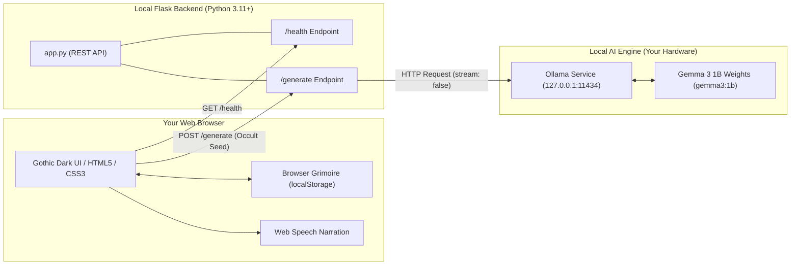

# GhostGPT 👻 — Offline AI Horror Story Generator

[](https://hacktoberfest.com/)
[](#hacktoberfest-theme-alignment)
[](https://ollama.com/)
[](https://github.com/google/gemma)
[](https://www.python.org/)
[](LICENSE)

> *"There is a spirit trapped in the silicon. It doesn't query the cloud. It doesn't send your words into the dark. It whispers from your machine, and yours alone."*

**GhostGPT** is an atmospheric, gothic web application that generates original horror and ghost stories using open-weight AI models running **100% locally on your computer**. Built for **Hacktoberfest 2026 (Week 4: "Ghost in the Machine")**, GhostGPT demonstrates why local, open-source AI is the true future of creative technology: total privacy, zero paid API keys, zero cloud telemetry, and complete offline capability.

---

## 🌟 Why Local Open-Source AI Matters

1. **🔒 Absolute Privacy & Data Sovereignty:** Your prompts, story seeds, and generated literature never touch external servers or cloud data centers.
2. **💸 Zero Subscriptions or Paid API Keys:** No OpenAI tokens, no credit card paywalls, and no monthly API charges.
3. **🌐 Truly Disconnected Operation:** Once your model is downloaded, you can pull your internet plug, sit by candlelight, and summon chilling tales in total isolation.
4. **🧠 Model Freedom:** Swap between Google's **Gemma 3 1B**, Llama 3.2, Mistral, or specialized horror fine-tunes with a simple environment variable change.

---

## 🏛️ System Architecture



---

## 🔮 Key Features

### 1. Archetype Horror Generator
Choose from six specialized horror archetypes, each with carefully calibrated narrative prompts:
- 🏚️ **Haunted House:** Ancient estates, creaking floorboards, locked doors, and ancestral curses.
- 👻 **Ghost Encounter:** Restless phantoms, cold spots, spectral whispers, and lingering spirits.
- 🔮 **Cursed Object:** Antiques, haunted mirrors, macabre music boxes, and relics demanding blood.
- 🏥 **Abandoned Sanatorium:** Echoing quarantine wards, rusted surgical tools, and lost patients.
- 🕵️ **Paranormal Mystery:** Vanished towns, occult investigations, cosmic anomalies, and riddles.
- 🧠 **Psychological Dread:** Paranoia, unreliable perception, sensory isolation, and fracturing reality.

### 2. Atmosphere & Length Controls
- **Horror Intensity:**
  - 🕯️ *Eerie & Chilling:* Subtle dread, creeping cold, and psychological tension.
  - 🩸 *Terrifying & Nightmarish:* Visceral danger, sudden confrontations, and frantic heartbeats.
  - 👁️ *Eldritch & Cosmic Dread:* Ancient malevolence, unknowable entities, and descent into madness.
- **Story Length:** Flash Fiction (~200 words), Short Tale (~400 words), or Novelette (~700 words).

### 3. Gothic Atmospheric Interface
- **Dark Obsidian Aesthetics:** Deep gothic palette (`#07060b`, `#151124`, `#00ffb3` ghostly green).
- **Animated Ambient Fog:** Layered drifting mist and floating spectral motes.
- **Reading Grimoire:** Parchment story chamber with drop-caps styling, font-size toggles (`A-` / `A+`), and word count / reading time diagnostics.
- **Audio Narration:** Built-in eerie whisper text-to-speech using the browser's Web Speech API.

### 4. Local Grimoire Archive
- Save generated stories to your browser's `localStorage` with a single click.
- Browse, reload into the reader, delete individual stories, or purge the archive.
- Export your complete grimoire as a formatted JSON document.

### 5. Resilient Diagnostics & Health Check
- Live status indicator displaying connection state to Ollama (`Online`, `Model Missing`, or `Offline`).
- Actionable on-screen terminal commands to guide users through starting Ollama or downloading missing models.

---

## 🚀 Quickstart Guide

### Prerequisites
1. **Python 3.11+** installed on your system.
2. **Ollama** installed ([download from ollama.com](https://ollama.com/download)).

### Step 1: Clone and Set Up the Environment

```bash
# Clone the repository
git clone https://github.com/your-username/GhostGPT.git
cd GhostGPT

# Create a virtual environment
python -m venv .venv

# Activate the virtual environment
# Windows (PowerShell):
.venv\Scripts\Activate.ps1
# macOS / Linux:
source .venv/bin/activate

# Install dependencies
pip install -r requirements.txt
```

### Step 2: Start Ollama and Pull Gemma 3

In a terminal, verify Ollama is running and pull the default **Gemma 3 1B** model:

```bash
# Start Ollama service (if not already running as a system tray service)
ollama serve

# In another terminal window, download the Gemma 3 1B model (~806 MB)
ollama pull gemma3:1b
```

### Step 3: Launch GhostGPT

```bash
# Run the Flask application
python app.py
```

Open your browser and navigate to:
👉 **`http://127.0.0.1:5000`**

---

## ⚙️ Configuration

Copy `.env.example` to `.env` to customize settings:

```bash
cp .env.example .env
```

| Environment Variable | Default | Description |
|---|---|---|
| `OLLAMA_HOST` | `http://localhost:11434` | Ollama REST API endpoint |
| `OLLAMA_MODEL` | `gemma3:1b` | Local model name (e.g., `gemma3:1b`, `llama3.2:1b`, `mistral`) |
| `GENERATION_TIMEOUT` | `90` | Story generation timeout in seconds |
| `FLASK_HOST` | `127.0.0.1` | Host address to bind Flask |
| `FLASK_PORT` | `5000` | Port for the web interface |
| `FLASK_DEBUG` | `false` | Enable/disable Flask debug mode |

---

## 🧪 Testing

GhostGPT includes a complete test suite covering input validation, health checks, title extraction, and Ollama failure modes:

```bash
# Run the test suite
pytest -v
```

All 13 unit and integration tests run with mocked Ollama endpoints to ensure lightning-fast CI/CD execution without external dependencies.

---

## 🎃 Hacktoberfest Theme Alignment: "Ghost in the Machine"

Week 4 of Hacktoberfest 2026 celebrates the theme **"Ghost in the Machine"**. 

GhostGPT embodies this concept both literally and philosophically:
1. **Literally:** It weaves eerie, supernatural ghost stories and gothic mysteries.
2. **Philosophically:** In 1949, philosopher Gilbert Ryle coined the phrase *"the ghost in the machine"* to describe the mystery of consciousness within physical bodies. In modern computing, deep neural networks are complex mathematical weights held in local RAM. When you run Gemma 3 completely disconnected from the internet, the stories that emerge feel like a true "ghost in the machine"—conjured from weights on your own hard drive without external direction.

---

## 📜 Project Structure

```
GhostGPT/
├── app.py                # Flask application & Ollama orchestration
├── requirements.txt      # Python dependencies
├── README.md             # Project documentation & guide
├── .gitignore            # Git exclusion rules
├── .env.example          # Sample environment variables
├── templates/
│   └── index.html        # Semantic HTML5 gothic interface
├── static/
│   ├── css/
│   │   └── style.css     # Atmospheric dark gothic styling & animations
│   └── js/
│       └── app.js        # Frontend client logic & localStorage Grimoire
└── tests/
    └── test_app.py       # Comprehensive pytest test suite
```

---

## 🛡️ License

Distributed under the **MIT License**. See `LICENSE` for details.
